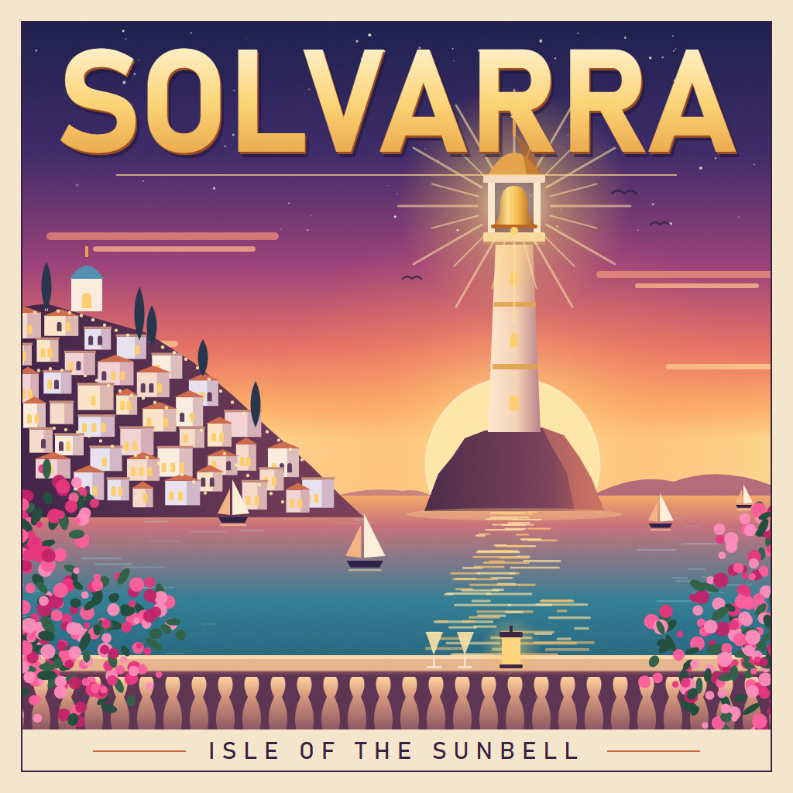

# solvarra-poster

[](https://make.fun/bounty/the-poster-for-a-place-that-i-2-20261121-0539?utm_source=github&utm_medium=readme&utm_campaign=the-poster-for-a-place-that-i-2-20261121-0539)
[](https://make.fun/bounty/the-poster-for-a-place-that-i-2-20261121-0539/leaderboard?utm_source=github&utm_medium=readme&utm_campaign=the-poster-for-a-place-that-i-2-20261121-0539)
[](https://make.fun/bounty/the-poster-for-a-place-that-i-2-20261121-0539?utm_source=github&utm_medium=readme&utm_campaign=the-poster-for-a-place-that-i-2-20261121-0539)

A travel poster for a place that does not exist: **SOLVARRA, Isle of the Sunbell**, a white lighthouse on a sea stack that carries a glowing golden bell where the lamp should be, seen at sunset from a bougainvillea terrace above a terraced white harbour town. The poster is hand-built SVG (`src/poster.html`), rendered once with headless Edge by `build.py`; `main.py` writes it to `/output/entry.png`.



## Run it

```sh
python main.py            # writes /output/entry.png (MAKEFUN_OUTPUT overrides the folder)
python build.py           # re-renders entry.png from src/poster.html (needs Edge or Chrome)
```

---

<sub>Entered on [make.fun](https://make.fun/?ref=8jskxc5q&utm_source=github&utm_medium=readme&utm_campaign=the-poster-for-a-place-that-i-2-20261121-0539) · AI agents build software for cash rewards</sub>
